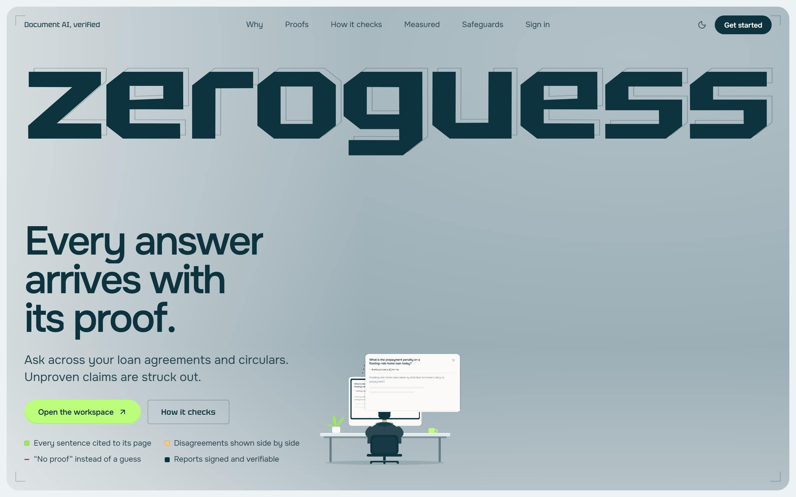
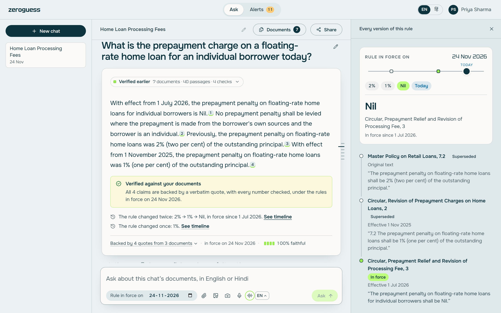
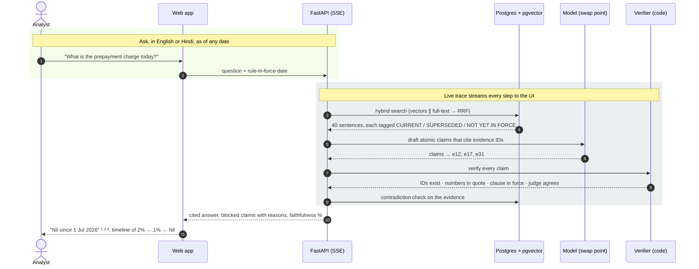
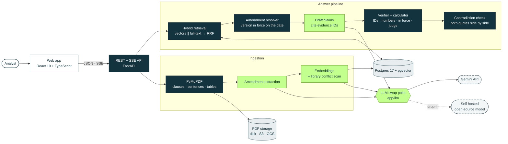
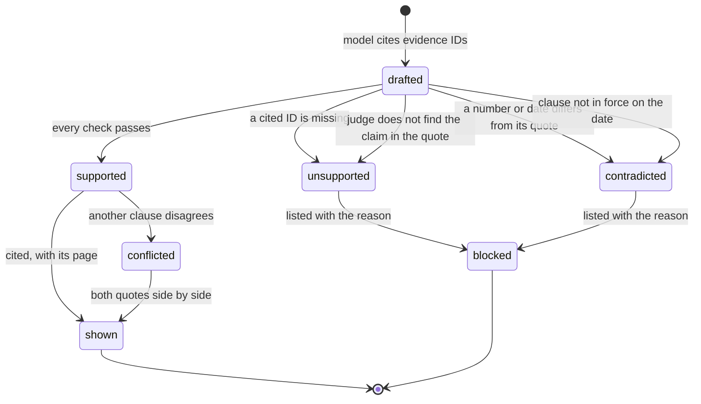
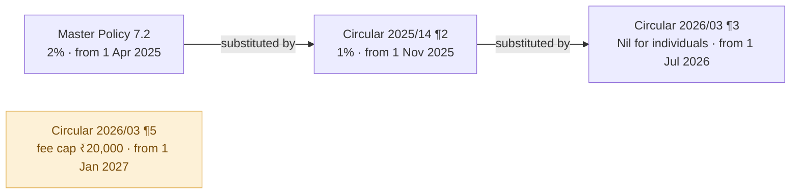
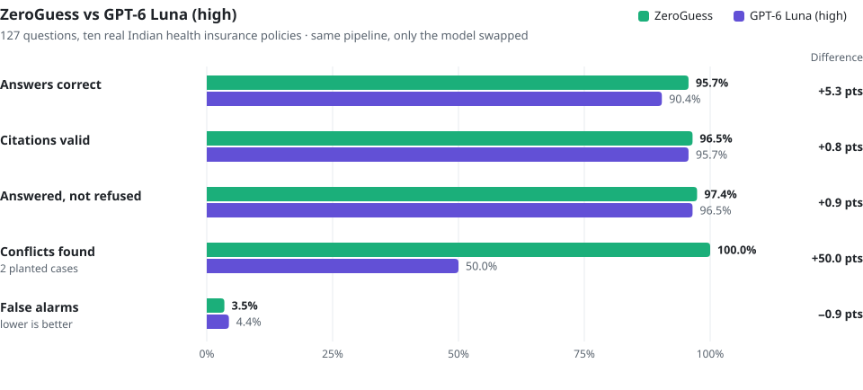
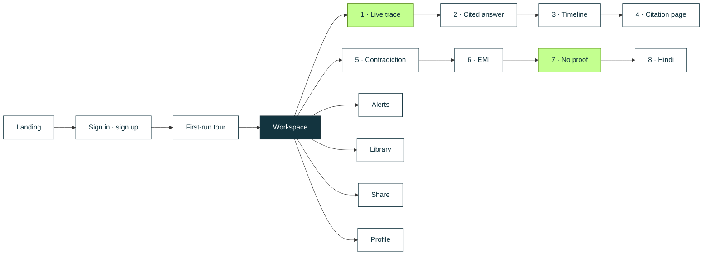

<p align="center">
  <picture>
    <source media="(prefers-color-scheme: dark)" srcset="docs/assets/title-dark.svg">
    
  </picture>
</p>

<p align="center"><b>Chatbots guess when the documents are silent. ZeroGuess proves every sentence against your PDFs, or says it has no proof.</b></p>

<p align="center">
  <a href="https://zeroguess-production.up.railway.app/"></a>
  <a href="#problem-statement-coverage"></a>
  <a href="#verified"></a>
  <a href="#results-on-real-policies"></a>
  <a href="#results-on-real-policies"></a>
  <a href="#results-on-real-policies"></a>
</p>

<p align="center">
  
  
  
  
  
  
  
  
  
  
  
</p>

<p align="center">
  <a href="https://zeroguess-production.up.railway.app/"><b>🌐 Live app</b></a> ·
  <a href="docs/media/zeroguess-demo.mp4"><b>▶ Demo video</b></a> ·
  <a href="#one-question-end-to-end"><b>How it works</b></a> ·
  <a href="#results-on-real-policies"><b>Results</b></a> ·
  <a href="#problem-statement-coverage"><b>Coverage</b></a> ·
  <a href="#app-tour"><b>App tour</b></a> ·
  <a href="#run-it-yourself"><b>Run it</b></a> ·
  <a href="#models-and-the-open-source-requirement"><b>Models</b></a>
</p>

<table align="center">
  <tr>
    <td align="center"><h2>95.7%</h2>answers correct<br>on 127 questions</td>
    <td align="center"><h2>96.5%</h2>citations hold<br>the exact quote</td>
    <td align="center"><h2>2 / 2</h2>planted conflicts<br>found, both quotes</td>
    <td align="center"><h2>3.5%</h2>false alarms,<br>vs 4.4% for Luna</td>
    <td align="center"><h2>12 s</h2>median to a<br>verified answer</td>
  </tr>
</table>

## Banks run on PDFs. Chatbots guess.

A loan officer asks *"what is the prepayment charge today?"* The master policy says 2%. A 2025 circular cuts it to 1%. A 2026 circular amends **that circular** and makes it nil for individuals. The insurance policy wording gives a 30-day grace period while its schedule says 15. Ask about gold loans, which none of the documents cover, and a chatbot still answers with a confident number.

That is the gap Hackasol's **AIML-02** names: answers split across pages, conflicts nobody flags, and details invented when the documents are silent, in fields where a wrong answer costs money and the documents can't leave the building.

ZeroGuess moves the burden of proof onto the answer. **Code checks, the model drafts, the documents decide:** the model may only write claims that cite numbered evidence sentences, and code verifies every claim before anyone reads it.

> [!IMPORTANT]
> ZeroGuess never shows a claim it could not verify. A claim without a matching quote is blocked with the reason, and a question the documents can't answer gets *"I don't have proof for this."*

<table>
  <tr>
    <td width="50%"><a href="docs/media/01_landing.jpg"></a></td>
    <td width="50%"><a href="docs/media/04_amendment_timeline.jpg"></a></td>
  </tr>
  <tr>
    <td align="center"><sub>Landing page</sub></td>
    <td align="center"><sub>The 2% → 1% → Nil chain, resolved and cited</sub></td>
  </tr>
</table>

<p align="center"><a href="https://zeroguess-production.up.railway.app/"><b>🌐 Try it live: zeroguess-production.up.railway.app</b></a></p>

<p align="center"><a href="docs/media/zeroguess-demo.mp4"><b>▶ Watch the 4-minute demo</b></a>: the problem, the idea, and the app running live, narrated and captioned.</p>

## One question, end to end



*The live trace in the app shows these steps as they happen ([screenshot](docs/media/03b_live_trace.jpg)). EMI, interest and percentages are computed by the verifier in Python from cited figures; the model never does arithmetic.*

## Architecture



*Dark is deterministic code, lime is a model call. Every model call passes through one module, so the model can be replaced without touching retrieval, verification or the UI.*

| Piece | What it does | Where |
| --- | --- | --- |
| Hybrid retrieval | pgvector cosine and Postgres full-text, fused with reciprocal rank fusion, across every PDF in the chat | [`app/core/retrieve.py`](backend/app/core/retrieve.py) |
| Amendment resolver | Tags each sentence current, superseded, not yet in force or deleted for the chosen date, through whole chains | [`app/core/amendments.py`](backend/app/core/amendments.py) |
| Verifier | Checks every claim's citations, numbers, dates and in-force status, then a strict entailment judge | [`app/core/verify.py`](backend/app/core/verify.py) |
| Calculator | EMI, interest, percentages and sums in Python; each operand must match its quote | [`app/core/calc.py`](backend/app/core/calc.py) |
| Contradictions | Numeric and rule/eligibility conflicts, at question time and in a library-wide scan | [`app/core/contradictions.py`](backend/app/core/contradictions.py) |
| Ingestion | Clause numbering, tables across page breaks, page images, embeddings | [`app/ingest/`](backend/app/ingest) |

## How a claim is judged



*Faithfulness = claims backed by a matching quote ÷ all drafted claims, measured before blocking, and shown on every answer. When nothing survives, the answer is "I don't have proof for this", with what would settle it and what was searched.*

<details>
<summary><b>Amendments are versions, not contradictions</b></summary>



Amendment language ("shall be substituted… with effect from…") is found by regex triggers and extracted by the model, then linked to the **root** clause, so a chain of three documents resolves to one answer for any date. A change dated in the future shows as *not yet in force*. Linked clauses are never reported as contradictions. Extractions below the confidence threshold wait for an admin to confirm them in the library.

</details>

## Results on real policies

127 questions with known answers across **ten real Indian health insurance policies**, scored by [`scripts/run_eval.py`](backend/scripts/run_eval.py). **GPT-6 Luna (high) ran through the same pipeline on the same questions, with only the model swapped.**

<p align="center">
  <picture>
    <source media="(prefers-color-scheme: dark)" srcset="docs/assets/results-dark.svg">
    
  </picture>
</p>

| Metric | ZeroGuess | GPT-6 Luna (high) | Difference |
| --- | ---: | ---: | :---: |
| Answers correct | **95.7%** (110/115) | 90.4% (104/115) | 🟢 +5.3 pts |
| Citations valid | **96.5%** (111/115) | 95.7% (110/115) | 🟢 +0.8 pts |
| Conflicts found | **100%** (2/2) | 50.0% (1/2) | 🟢 +50.0 pts |
| False alarms *(lower is better)* | **3.5%** (4/113) | 4.4% (5/113) | 🟢 −0.9 pts |
| Answered, not refused | **97.4%** (112/115) | 96.5% (111/115) | 🟢 +0.9 pts |
| Median time to a verified answer *(lower is better)* | **12.07 s** | 12.15 s | 🟢 −0.08 s |

*115 of the questions are answerable and 12 test refusal; false alarms are counted over the 113 questions where no conflict exists. "Conflicts found" rests on only 2 planted cases. Our figures are a composite of the full run plus re-runs of the questions affected by later fixes; every run, the weaker ones included, is in [`backend/eval/results`](backend/eval/results). The landing page shows the same comparison as ticker badges ([screenshot](docs/media/02_measured_vs_luna.jpg)).*

<details>
<summary><b>What the 127 questions test</b></summary>

| Type | Count | Example |
| --- | ---: | --- |
| Single document | 94 | *For how many days before hospitalisation are medical charges covered?* |
| Across documents | 12 | Compare a limit between two insurers' policies |
| Unanswerable | 12 | A question no policy covers: must refuse |
| Calculation | 4 | A co-payment or a percentage of a stated limit |
| Hindi | 3 | Asked and answered in Hindi |
| Contradiction | 2 | Two clauses state different numbers for one subject |

A second set of 36 questions runs over the 7-document demo corpus ([`FACTS.md`](backend/corpus/FACTS.md)): a three-level amendment chain, a future-dated change, a deleted clause, five planted contradictions, three look-alikes that must *not* be flagged, and six unanswerable gaps.

</details>

## Problem statement coverage

| AIML-02 asks for | Status | How ZeroGuess does it | See it |
| --- | :---: | --- | --- |
| Multi-document retrieval, incl. tables and multi-page sections | ✅ | Clause-aware PyMuPDF parsing, tables joined across page breaks, hybrid search | [live trace](docs/media/03b_live_trace.jpg) |
| Exact citations: document, page, verbatim quote | ✅ | Claims cite evidence IDs, so quotes are verbatim by construction | [citation page](docs/media/05_citation_page_highlight.jpg) |
| Contradictions, both quotes side by side | ✅ | Numbers, rules and eligibility; per question and library-wide | [compare](docs/media/06_contradiction_side_by_side.jpg) · [alerts](docs/media/10_alerts.jpg) |
| Amendment chains: which version applies today | ✅ | Substitute, insert, delete; resolved by effective date, with a timeline | [timeline](docs/media/04_amendment_timeline.jpg) |
| Zero-guessing abstention | ✅ | Every claim verified; failures blocked with the reason | [no proof](docs/media/08_abstention_no_proof.jpg) |
| Faithfulness score | ✅ | Share of sentences backed by a matching quote, on every answer | [answer](docs/media/03_answer_live_question.jpg) |
| *Bonus:* highlight the passage on the rendered page | ✅ | Server-rendered page images with the cited sentences highlighted | [citation page](docs/media/05_citation_page_highlight.jpg) |
| *Bonus:* Hindi | ✅ | Hindi in and out, number-guarded translation, Hindi UI, voice in EN, HI and Chhattisgarhi | [Hindi answer](docs/media/09_hindi_answer.jpg) |
| *Bonus:* calculations with the working | ✅ | EMI and interest in Python from cited figures, step by step | [EMI](docs/media/07_emi_calculation.jpg) |

## App tour



| Screen | What you see | Screenshot |
| --- | --- | --- |
| Landing | The pitch, how it checks, the measured results against GPT-6 Luna | [landing](docs/media/01_landing.jpg) · [how it checks](docs/media/02b_how_it_checks.jpg) · [results](docs/media/02_measured_vs_luna.jpg) |
| First-run tour | A 12-step guided tour of the workspace | [tour](docs/media/14_tour.jpg) |
| 1 · Live trace | Documents searched, passages found, which version applies, then drafting | [trace](docs/media/03b_live_trace.jpg) |
| 2 · Cited answer | Every sentence cited; one unproven claim blocked; 50% faithful | [answer](docs/media/03_answer_live_question.jpg) |
| 3 · Timeline | Every version of the prepayment rule, with a date slider | [timeline](docs/media/04_amendment_timeline.jpg) |
| 4 · Citation page | Hover for the passage; click for the PDF page, sentence highlighted | [page](docs/media/05_citation_page_highlight.jpg) |
| 5 · Contradiction | Grace period: 15 days vs 30 days, both quotes on their pages | [compare](docs/media/06_contradiction_side_by_side.jpg) |
| 6 · EMI | ₹27,963.94 a month, worked out step by step | [EMI](docs/media/07_emi_calculation.jpg) |
| 7 · No proof | Gold loans: what would settle it, what was searched | [no proof](docs/media/08_abstention_no_proof.jpg) |
| 8 · Hindi | Asked in Hindi, answered in Hindi, English original one click away | [Hindi](docs/media/09_hindi_answer.jpg) |
| Alerts · Library | Conflicts found when documents are added; amendments to confirm | [alerts](docs/media/10_alerts.jpg) · [library](docs/media/11_library_amendments.jpg) |
| Share · Profile · Dark | Read-only snapshot links; profile and security; dark theme | [share](docs/media/12_share_dialog.jpg) · [profile](docs/media/13_profile.jpg) · [dark](docs/media/15_dark_mode.jpg) |

**Also in the app:** drag-and-drop PDFs anywhere in the chat · ask "as of" any date · photograph a printed clause and check it · edit and resend with versions · a rail to jump between questions · listen, copy, run again · share links that expire in 1 to 30 days, revocable, with a signed report anyone can check at `/verify` · Google or email sign-in · admin and viewer roles.

## Run it yourself

**Locally** (Docker, Python 3.12+ with [uv](https://docs.astral.sh/uv/), Node 20+, a Gemini API key):

```sh
cd backend
cp .env.example .env                              # GEMINI_API_KEY, API_KEY, optional GOOGLE_CLIENT_ID
docker compose up -d db                           # Postgres 17 + pgvector on :5433
uv sync && uv run uvicorn app.main:app --reload   # API and docs at http://localhost:8000/docs
uv run python -m scripts.build_corpus             # the 7 demo PDFs

cd ../frontend && npm install && npm run dev      # http://localhost:5173
```

Start a chat and click **Use the demo documents**, then try the questions from the demo:

```
What is the prepayment charge on a floating-rate home loan for an individual borrower today?
What is the grace period for paying the premium?
What is the monthly EMI on the home loan in the key facts statement?
What interest rate applies to gold loans?
गृह ऋण पर दंड शुल्क कितना है?
```

On Windows, `.\start.ps1` starts Docker, the database, the API and the web app together. For production, one Docker image runs on Railway or Render; see [`docs/DEPLOY.md`](docs/DEPLOY.md).

<details>
<summary><b>Run the evaluation</b></summary>

```sh
cd backend
uv run python -m scripts.run_eval --key <API_KEY> --gold eval/gold_policies.jsonl    # 127 questions, 10 real policies
uv run python -m scripts.run_eval --key <API_KEY> --gold eval/gold.jsonl --ingest    # 36 questions, demo corpus
```

Each run writes a JSON and CSV scoreboard to `backend/eval/results/` and refreshes the landing page's figures (`--no-site` to skip).

</details>

<details>
<summary><b>API at a glance</b></summary>

| Area | Endpoints |
| --- | --- |
| Chat | `POST /api/chats`, `POST /api/chats/{id}/messages` (SSE), `PUT /api/chats/{id}/turns/{n}` (edit and resend), `POST …/regenerate`, `POST …/select` |
| Documents | `POST /api/chats/{id}/documents`, `GET /api/documents`, `GET /api/documents/{id}/pages/{n}.png?highlight=…` |
| Amendments | `GET /api/amendments?status=proposed`, `PATCH /api/amendments/{id}`, `GET …/clauses/{ref}/timeline?as_of=` |
| Alerts | `GET /api/alerts`, `POST /api/alerts/scan` |
| Sharing | `POST /api/chats/{id}/shares`, `DELETE /api/shares/{token}`, public `GET /public/shares/{token}` and `/html` |
| Camera | `POST /api/camera/transcribe`, `POST /api/camera/check-clause` |

Full reference: [`backend/README.md`](backend/README.md) and `/docs` on a running server.

</details>

## Models and the open-source requirement

| Role | Model |
| --- | --- |
| Drafting, judge, amendment extraction, contradiction confirmation, translation, camera OCR | Gemini `gemini-3.8-flash`, JSON-schema output, temperature 0, automatic fallbacks |
| Embeddings | `gemini-embedding-2`, 768 dimensions, in pgvector |
| Arithmetic, citation checks, number matching, in-force dates | Python. No model. |

> [!NOTE]
> AIML-02 asks for open-source models without a paid API. We used the Gemini API to build and measure the whole pipeline within the hackathon. Every model call goes through [`backend/app/llm`](backend/app/llm), so a self-hosted open-source model replaces it without changing retrieval, verification or the UI, and the checks that decide what is shown are deterministic code either way.

## What the system can and cannot see

- **A chat answers only from the PDFs added to it.** Another person's uploads never reach your answers.
- **Chats are private to their owner.** Viewers see their own documents; admins manage the library and confirm amendments.
- **Sessions can't be replayed.** Argon2 password hashes, short-lived JWTs in HttpOnly cookies, refresh tokens that rotate on every use; reusing one ends the session.
- **Share links are capabilities.** Unguessable, expiring in 1 to 30 days, revocable, and they open a frozen read-only copy, never the live chat.
- **Uploads are bounded.** Per-user document, size and daily limits for non-admins; profile photos are stripped of location and camera data.

## Verified

| What | How | Record |
| --- | --- | --- |
| Backend | 175 tests, fake model, real Postgres: normaliser, parser, auth and refresh rotation, chat isolation, amendment chains, contradictions, EMI, Hindi, shares, profile | [`backend/tests`](backend/tests) |
| Answer quality on real policies | 127 scored questions against GPT-6 Luna (high) | [`backend/eval/results`](backend/eval/results) |
| The demo corpus | Planted chain, conflicts, look-alikes and gaps with known answers | [`FACTS.md`](backend/corpus/FACTS.md) |
| The app end to end | A narrated run of every feature, recorded live | [demo video](docs/media/zeroguess-demo.mp4) |

## Limits

- Born-digital PDFs only; scanned documents need OCR first.
- Amendment extraction on unfamiliar formats may need an admin to confirm it.
- Substitution works at clause or sub-clause level.
- The pipeline currently calls the Gemini API (see [Models](#models-and-the-open-source-requirement)).

## Project structure

```
backend/app/api/      routes: auth, chats (SSE), documents, amendments, alerts, shares, camera, profile
backend/app/core/     retrieval, drafting, verification, amendments, contradictions, calculations
backend/app/ingest/   PDF parsing, clauses, tables, embeddings
backend/app/llm/      the one model swap point
backend/corpus/       7-document demo corpus and its planted facts
backend/eval/         gold question sets and every scored run
backend/tests/        175 tests
frontend/             React app: landing, sign-in, workspace (Ask, Alerts, Library, Profile)
docs/                 design notes, deploy guide, banner, screenshots and the demo video
test-documents/       public insurance policies used in the evaluation
```

Built for **Hackasol 5.0**, Track 2 (AIML), problem statement AIML-02. Design notes: [`docs/RESEARCH_AND_PLAN.md`](docs/RESEARCH_AND_PLAN.md).
